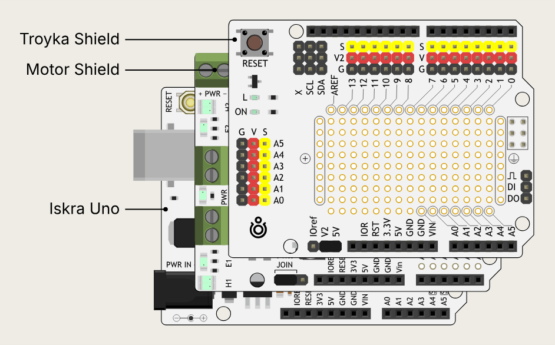
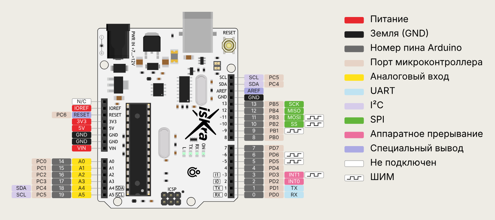

# Olympiad-Robot-Lessons

Три урока по роботу на Arduino, который едет по линии: от первого включения до ПД-регулятора и подсчета
перекрестков.

## О курсе

Курс знакомит с базовыми алгоритмами олимпиадной робототехники: от управления движением до езды по линии с ПД-регулятором и подсчета перекрестков.

Занятия рассчитаны на участников, которые уже знакомы с основами робототехники, работой с платами Arduino и синтаксисом C/C++.

К каждому уроку прилагаются страница с теорией и схемой подключения, а также скетч-заготовка с заданиями, отмеченными комментариями `// TODO`. Уроки идут по порядку: заготовка следующего урока содержит решение предыдущего,
поэтому не открывайте ее раньше времени. Работу регулятора показывают видео в папке [`assets/video`](assets/video/). В тексте уроков приведены иллюстрации и ссылки на видео.

## Уроки

1. [Питание и движение](lesson-01-movement/) — включить робота, понять, как устроено питание, написать функцию `motors(...)`. Дополнительно — проехать квадрат.
2. [Датчики линии и ПД-регулятор](lesson-02-line-pd/) — откалибровать датчики, посчитать ошибку, подобрать коэффициенты `kp` и `kd`.
3. [Перекрестки](lesson-03-crossroads/) — найти перекресток по двум датчикам, сосчитать перекрестки, остановиться на третьем.

Решения заданий — в папке [`answers`](answers/), тестовый скетч для проверки робота — в [`lesson-00-robot-test`](lesson-00-robot-test/).

## Оборудование

Робот собран на круглом шасси диаметром 160 мм и весит около 350 г. Электроника стоит стопкой плат:
снизу контроллер Iskra Uno, над ним драйвер моторов Motor Shield, сверху Troyka Shield для подключения
датчиков. Под стопкой — модуль питания и отсек с аккумуляторами.

- **Iskra Uno** — контроллер на ATmega328P, 16 МГц, полностью совместим с Arduino Uno.
- **Amperka Motor Shield** — драйвер двух моторов на микросхеме L298P, каналы M1 и M2.
- **Amperka Troyka Shield** — выводит каждый пин контроллера на тройку S-V-G.
- **Модуль питания** — DC-DC-преобразователь MP2225 (выход VCC, 6 В) и стабилизатор L7805 (выход 5V).
- **2 × 18650** — аккумуляторы Li-ion, вместе 7,4–8,4 В.
- **GA12-N20 1:50 с энкодером, 2 шт.** — мотор-редукторы, колеса ⌀43 мм.
- **Датчик линии TCRT5000, 2 шт.** — аналоговые датчики: на белом выдают больше, на черном — меньше.

Подключение моторов одинаковое во всех уроках, датчики линии подключаются со второго занятия.
Левый мотор стоит на канале M2: направление — D7, скорость — D6. Правый мотор — на канале M1: направление — D4,
скорость — D5. Направление задается командой `digitalWrite()`, скорость — `analogWrite()` на D6 и D5.
Левый датчик линии — A0, правый — A1, их показания читает `analogRead()`.

Распиновка Iskra Uno — на случай, если понадобятся другие пины:

## Как начать

Предполагается, что Arduino IDE уже установлена.

Iskra Uno программируется как обычная Arduino Uno. Подключите робота по USB. В верхней части окна Arduino IDE откройте список «Select Board». Выберите подключенную плату и порт. Если нужной платы нет в списке, нажмите «Select other board and port…», выберите «Arduino Uno» и порт, который появился после подключения.

Другой способ: в меню «Tools → Board» выберите «Arduino AVR Boards → Arduino Uno», в «Tools → Port» — порт, который появился после подключения.

Скачайте уроки кнопкой «Code → Download ZIP» и распакуйте архив. Скетч находится в папке соответствующего урока по пути
`firmware/<урок>/<урок>.ino` — Arduino IDE требует, чтобы папка и скетч назывались одинаково, поэтому не
переименовывайте их. Монитор и плоттер порта открывайте на скорости 115200: так настроен `Serial` во всех
уроках.

## Документация

Техническая документация платформы, даташиты и схемы лежат в папке [`assets/datasheets`](assets/datasheets/).

| Документ | Что внутри |
|---|---|
| [Техническая документация платформы](assets/datasheets/platform-tech-doc.pdf) | Состав робота, питание и коммутация, платы, датчики и сервоприводы |
| [Arduino Uno](assets/datasheets/arduino-uno.pdf) | Плата, с которой совместима Iskra Uno: пины и питание |
| [Motor Shield](assets/datasheets/motor-shield.pdf) | Драйвер моторов: каналы, пины управления, перемычки |
| [HC-SR04](assets/datasheets/hc-sr04.pdf) | Ультразвуковой дальномер |
| [Sharp GP2Y0A21](assets/datasheets/gp2y0a21.pdf) | Инфракрасный дальномер |
| [Схема модуля питания](assets/datasheets/schematics/power_module_schematic.png) | DC-DC и LDO, предохранители, светодиоды линий |
| [Схема датчика линии](assets/datasheets/schematics/line_sensor_schematic.png) | Оптопара TCRT5000 и выход S |
| [Схема Arduino Uno](assets/datasheets/schematics/arduino_uno_schematic.png) | Принципиальная схема платы |
| [Схема Motor Shield](assets/datasheets/schematics/arduino_motor_shield_schematic.png) | Принципиальная схема драйвера на L298P |

Справочник языка Arduino — на сайте [docs.arduino.cc](https://docs.arduino.cc/language-reference/).

## Лицензия

[MIT](LICENSE)
