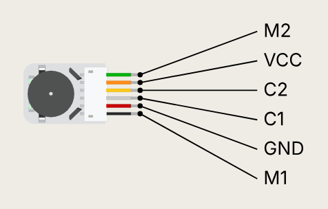

# Урок 0. Проверка робота

[Оглавление](../README.md) · [Урок 1 →](../lesson-01-movement/)

## Цель

Перед первым уроком нужно убедиться, что робот исправен: моторы вращаются в нужную сторону, энкодеры считают тики, датчики выдают показания. Для проверки используем скетч с готовыми тестами. Нужный тест включается раскомментированием строки.

## Как устроен скетч

Скетч состоит из двух файлов в одной папке, Arduino IDE открывает их в соседних вкладках:

- [`lesson-00-robot-test.ino`](firmware/lesson-00-robot-test/lesson-00-robot-test.ino) — `setup()` и `loop()` с вызовами тестов;
- [`lesson-00-robot-test.h`](firmware/lesson-00-robot-test/lesson-00-robot-test.h) — реализация тестов, пины, функция `motors(...)` и подсчет тиков энкодеров.

В начале `setup()` вызывается `robotInit()`: функция настраивает пины, включает прерывания энкодеров, подключает серво и открывает порт на скорости 115200. Результаты выводятся в монитор порта. Обозначения: L и R — левый и правый, Hz — тики в секунду, mm — путь колеса в миллиметрах, cm — расстояние в сантиметрах.

Тесты в `setup()` блокируют выполнение программы до своего завершения. Тесты в `loop()` выполняются по шагам и позволяют между вызовами выполнять другой код. Большинство из них вызываются в блоке с таймером раз в 100 мс. Исключения указаны в таблице тестов.

## Схема подключения

Моторы и датчики линии подключены так же, как в уроках 1–3. Новое здесь — энкодеры.

### Энкодер

От мотора GA12-N20 идет шлейф из шести проводов: два подключены к мотору, четыре — к энкодеру. На валу мотора установлен магнитный диск, рядом — два датчика Холла. За один оборот вала каждый датчик выдает 7 импульсов. При передаточном отношении редуктора 1:50 на оборот колеса приходится 7 · 50 = 350 тиков. Для колеса диаметром 43 мм один тик соответствует пути π · 43 / 350 ≈ 0,39 мм.

Сигналы C1 и C2 сдвинуты на четверть периода. Скетч считает фронты C1: при срабатывании прерывания считывает уровень C2 и определяет направление вращения. В зависимости от направления счетчик увеличивается или уменьшается. C1 подключается к D2 или D3 — пинам внешних прерываний, C2 — к D8 или D9.

### Подключение

| Что подключено | Провод | Левая сторона | Правая сторона | Зачем |
|---|---|---|---|---|
| Мотор: канал Motor Shield | — | M2 | M1 | Каждым мотором управляет свой канал драйвера |
| Мотор: направление | — | D7 | D4 | `digitalWrite()`: HIGH или LOW задает направление вращения |
| Мотор: скорость | — | D6 | D5 | `analogWrite()`: ШИМ от 0 до 255 задает скорость |
| Мотор: вывод M2 | Зеленый | Клеммник M2 «+» | Клеммник M1 «+» | Питание мотора от драйвера |
| Мотор: вывод M1 | Черный | Клеммник M2 «−» | Клеммник M1 «−» | Питание мотора от драйвера |
| Энкодер: VCC | Оранжевый | V тройки D2 | V тройки D3 | Питание энкодера, 5 В |
| Энкодер: GND | Красный | G тройки D2 | G тройки D3 | Земля энкодера |
| Энкодер: C1, сигнал A | Белый | S тройки D2 | S тройки D3 | Фронты C1 считает прерывание — оно есть только у D2 и D3 |
| Энкодер: C2, сигнал B | Желтый | S тройки D8 | S тройки D9 | Уровень C2 в момент фронта C1 показывает направление вращения |
| Датчик линии | Шлейф S-V-G | Тройка A0 | Тройка A1 | `analogRead()`: над белым показания выше, над черным ниже |

> [!WARNING]
> В шлейфе энкодера красный провод — земля, а оранжевый — питание. Не подключайте красный провод к V.

Если на роботе установлены дополнительные датчики: Sharp — A2, HC-SR04 — TRIG D12 и ECHO D13, серво — D10 и D11.

## Тесты

| Тест | Где вызывать | Что делает |
|---|---|---|
| `motorsTestSetup()` | `setup()` | Разворот на месте: разгон 2 с и снижение ШИМ до нуля за 2 с, вывод показаний энкодеров. Включен по умолчанию |
| `wheelsTest()` | `setup()` | Вращение колес по очереди: левое вперед и назад, правое вперед и назад, оба вперед — по 1 с |
| `driveTest(2000, 150)` | `setup()` | Заезд по полу без USB: измерение скорости, выбега и различия моторов. Результат сохраняется в EEPROM |
| `encPrint()` | `loop()`, в блоке с таймером | Тики, частота и путь колес. Включен по умолчанию |
| `encPinsPrint()` | `loop()`, без таймера, отдельно от остальных тестов | Проверка сигналов энкодеров при вращении колес рукой |
| `motorsTest()` | `loop()`, без таймера | Аналог `motorsTestSetup()`, который выполняется по шагам и не блокирует `loop()` на время всего теста |
| `sensors()` | `loop()`, в блоке с таймером | Показания датчиков линии L, R и разность err = L − R |
| `sharpPrint()` | `loop()`, в блоке с таймером | Показание АЦП датчика Sharp |
| `hcPrint()` | `loop()`, в блоке с таймером | Расстояние по HC-SR04, cm |
| `servoTest()` | `loop()`, в блоке с таймером | Поворот обоих серво: 0 → 180 → 0 градусов с шагом 10 градусов |

### Моторы и энкодеры: motorsTestSetup()

> [!WARNING]
> Перед загрузкой поднимите робота или поставьте его на подставку, чтобы колеса не касались поверхности. Тест запускается сразу после загрузки.

Левое колесо вращается вперед, правое — назад. ШИМ плавно увеличивается от 0 до 255 и уменьшается до нуля. Тест занимает около 4 с. Раз в 100 мс выводятся показания энкодеров:

    L 812 1650Hz 314mm  R -806 -1640Hz -311mm

Счетчик левого колеса увеличивается, правого — уменьшается, поскольку оно вращается назад. Частоты вращения близки по модулю. После остановки `loop()` продолжает выводить показания энкодеров.

### Направление колес: wheelsTest()

Перед каждым шагом в порт выводится метка: `L+`, `L-`, `R+`, `R-`, `LR+`. «+» означает движение колеса вперед, «−» — назад. На шаге `LR+` оба колеса должны вращаться вперед. Если направление не совпадает с меткой, проверьте подключение мотора и инверсию в `motors(...)`.

### Пины энкодеров: encPinsPrint()

Если один из энкодеров показывает 0, оставьте в `loop()` только вызов `encPinsPrint();`. Загрузите скетч и медленно вращайте колесо рукой. Раз в 200 мс выводятся состояния четырех пинов:

    D2 1/57  D8 0/56  D3 0/0  D9 1/41

`D2 1/57` означает: на пине сейчас уровень 1, зарегистрировано 57 изменений уровня. При вращении колеса счетчики изменений должны увеличиваться на обоих пинах его энкодера. В примере на D3 изменений нет. Проверьте провод C1 правого энкодера и контакт в тройке D3 на Troyka Shield.

### Заезд по полу: driveTest()

Тест измеряет различие моторов под нагрузкой. Подготовьте не менее метра свободного пути на полу.

1. Раскомментируйте `driveTest(2000, 150);`, закомментируйте `motorsTestSetup();` и загрузите скетч. При загрузке держите колеса в воздухе.
2. Отключите USB и выключите питание. Поставьте робота на пол и включите питание. Через 2 с робот начнет движение, проедет 2 с на ШИМ 150 и остановится. Если его уводит в сторону, измерению это не мешает.
3. Выключите питание, поднимите робота и подключите USB. Откройте монитор порта: после перезапуска плата выведет результат прошлого заезда из EEPROM. Через 2 с тест запустится снова — держите колеса в воздухе.

Пример отчета:

    speed 150 2000ms
    v L 292 R 270 mm/s
    coast L 34 R 27 mm 250ms
    rev L 3.21 R 2.97 d 7.8%
    pwm L 138 R 150

| Строка | Что значит |
|---|---|
| `v` | Скорость колес после разгона, mm/s |
| `coast` | Путь колес после `motors(0, 0)`, mm, и время до остановки, ms |
| `rev` | Обороты колес за время движения и их различие d, % |
| `pwm` | Оценка поправки ШИМ для выравнивания скоростей. Можно использовать как начальные значения в задании 2 урока 1 |

Этот тест проводят на полу: результаты без нагрузки могут отличаться от результатов при движении робота.

### Датчики и серво: sensors(), sharpPrint(), hcPrint(), servoTest()

Раскомментируйте нужный вызов в блоке с таймером. Функция `sensors()` используется и в уроке 2: над белым показания выше, над черным — ниже. Остальные тесты нужны, если на роботе установлены Sharp, HC-SR04 или серво.

## Как проверить

Робот исправен, если:

- в `motorsTestSetup()` оба колеса плавно разгоняются и замедляются, счетчик левого энкодера увеличивается, правого — уменьшается;
- в `wheelsTest()` направление вращения каждого колеса совпадает с меткой;
- при повороте колеса рукой на один оборот энкодер отсчитывает примерно 350 тиков;
- показания `sensors()` заметно различаются над белой и черной поверхностями.

## Частые ошибки

| Что происходит | Что проверить |
|---|---|
| В мониторе порта нечитаемые символы | Установите скорость 115200 |
| Один энкодер все время показывает 0 | Проверьте питание энкодера и контакт C1 с помощью `encPinsPrint()` |
| Счетчик меняется только в одну сторону независимо от вращения колеса | Проверьте контакт C2: его уровень может не меняться |
| Знак тиков не совпадает с направлением вращения | Проверьте порядок подключения C1 и C2 и настройку направления счета |
| Светодиод энкодера не горит | Проверьте питание: красный провод — земля, оранжевый — питание |
| Колеса не вращаются, энкодеры показывают 0 | Проверьте выключатель: от одного USB моторы не работают |
| В `driveTest()` различие моторов почти нулевое | Убедитесь, что тест проводился на полу, а не с поднятыми колесами |

## Подумать

Почему C1 обоих энкодеров подключен к D2 и D3, а не к любым свободным пинам?

Робот проехал 1050 тиков по обоим колесам. Сколько это миллиметров?
