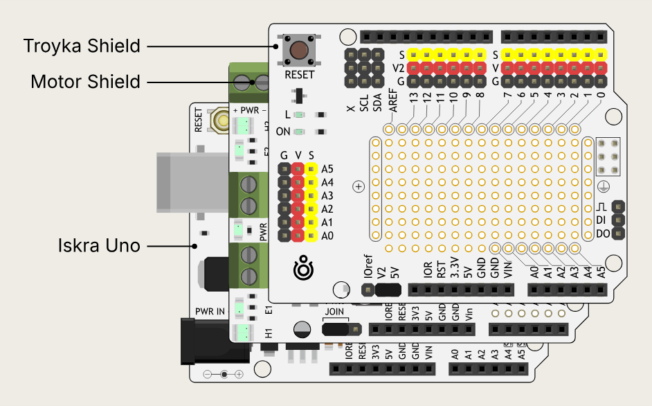
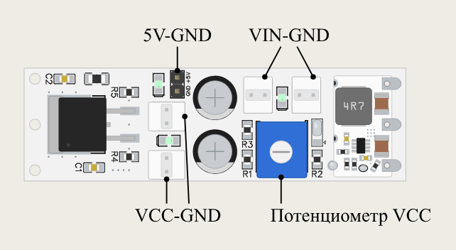
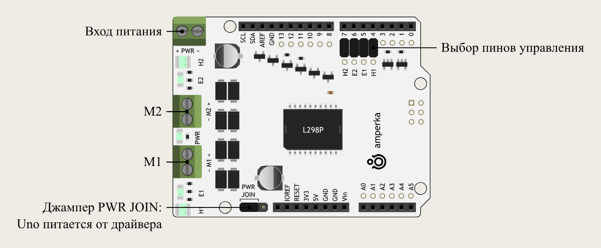
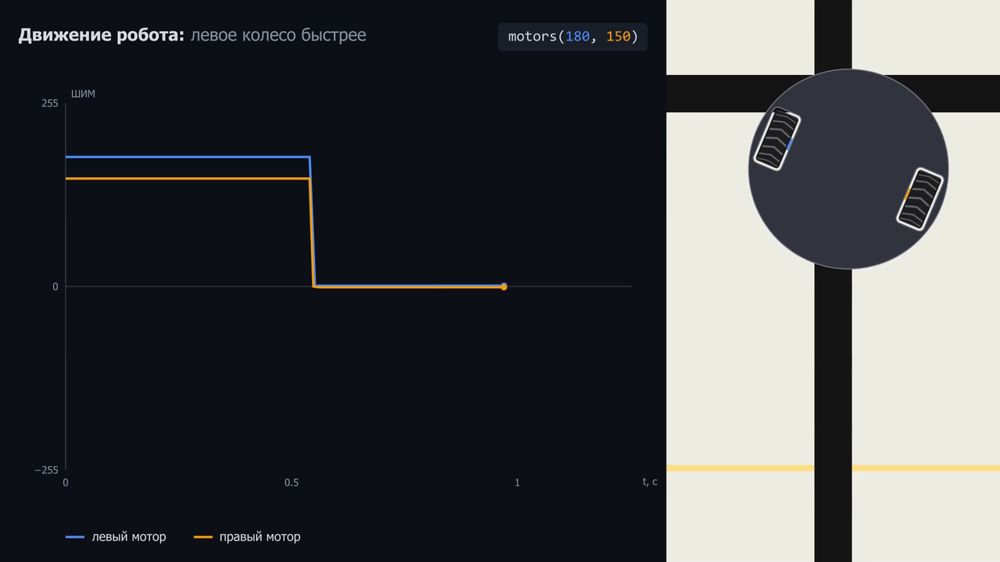
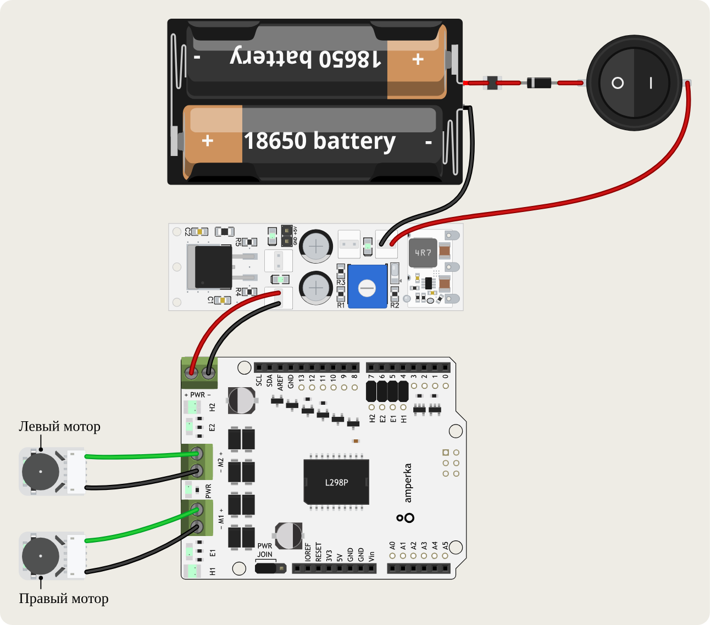

# Урок 1. Питание и движение

[← Урок 0](../lesson-00-robot-test/) · [Оглавление](../README.md) · [Урок 2 →](../lesson-02-line-pd/)

## Цель

Включить робота, разобраться, как питание доходит от аккумуляторов до моторов и контроллера, и написать функцию `motors(...)`, которой робот будет управлять колесами во всех следующих уроках. Дополнительное задание — проехать квадрат на треке.

## Теория

### Из чего состоит робот

Электроника робота — это стопка плат. Внизу контроллер Iskra Uno: он выполняет программу. На него надет драйвер Motor Shield: контроллер не может напрямую подать на мотор сотни миллиампер, а драйвер может — он усиливает слабые сигналы с пинов до тока, который нужен моторам. Сверху стоит Troyka Shield — плата, которая выводит каждый пин на удобную тройку контактов для датчиков. Под стопкой расположены модуль питания и два аккумулятора.

<p align="center"></p>

### Питание

Робот питается от двух последовательно соединенных аккумуляторов 18650: в зависимости от заряда это 7,4–8,4 В. Модуль питания делит это напряжение на две линии. Импульсный DC-DC-преобразователь выдает на выход VCC стабилизированные 6 В, которые не падают по мере разряда аккумуляторов. Поэтому одно и то же значение ШИМ дает одну и ту же скорость и в начале занятия, и в конце, и подобранные коэффициенты не придется перенастраивать. Линейный стабилизатор (LDO) выдает на выход 5V чистые 5 В для датчиков. В базовой схеме от VCC питаются и моторы, и контроллер: перемычка PWR JOIN на Motor Shield передает это напряжение на вход VIN Iskra Uno. У каждой линии есть свой светодиод. Если он погас, сработала защита от короткого замыкания — немедленно выключите питание и проверьте схему.

- **VIN-GND** — 7,4–8,4 В, до 3 А, синий светодиод: вход от аккумуляторов.
- **VCC-GND** — 6 В, до 3 А, желтый светодиод: моторы и контроллер (через PWR JOIN).
- **5V-GND** — 5 В, до 1 А, зеленый светодиод: датчики.

<p align="center"></p>

> [!NOTE]
> Для Arduino Uno рекомендуемое напряжение на входе VIN составляет 7–12 В. В нашей схеме на VIN поступает 6 В, поэтому после встроенного стабилизатора напряжение питания контроллера может оказаться ниже 5 В. Это отступление от рекомендованного режима, а не универсальный способ питания платы. При напряжении ниже 7 В производитель предупреждает о возможной нестабильной работе. При питании от USB напряжение на самой плате обычно тоже немного ниже 5 В из-за падения напряжения в кабеле и на разъеме.

### Motor Shield: два пина на мотор

Каждым мотором драйвер управляет по двум пинам. Первый задает направление вращения: это обычный цифровой сигнал HIGH или LOW. Второй задает скорость: на него подается ШИМ-сигнал командой `analogWrite(pin, duty)`, где заполнение `duty` — число от 0 (стоп) до 255 (полная мощность). Левый мотор подключен к каналу M2 и управляется пинами D7 (направление) и D6 (скорость), правый — к каналу M1, пины D4 и D5. Пины D4 и D7 не умеют выдавать ШИМ, поэтому на роль пинов скорости драйвер берет D5 и D6.

Рядом с клеммниками моторов стоят светодиоды, по которым удобно проверять программу, даже если моторы не подключены. H1 и H2 показывают направление: зеленый — HIGH, красный — LOW. Яркость E1 и E2 пропорциональна скорости. Светодиод PWR горит, когда на драйвер подано питание.

<p align="center"></p>

### Функция motors(...)

Научим робота двигаться с помощью функции `motors(...)`. Она принимает два числа — по одному на каждый мотор: знак задает направление, модуль — скорость. Сначала `constrain()` ограничивает число диапазоном от −255 до 255, чтобы аргументы за пределами этого диапазона не нарушали работу функции. Затем сравнение `left > 0` дает `true` или `false`, а `digitalWrite()` понимает их как HIGH и LOW — так отдельной строкой задается направление. Наконец, `abs()` отбрасывает знак, и модуль числа уходит на пин, управляющий скоростью.

```cpp
void motors(int16_t left, int16_t right) {
  left = constrain(left, -255, 255);
  right = constrain(right, -255, 255);
  digitalWrite(L_DIR, left > 0);
  digitalWrite(R_DIR, right > 0);
  analogWrite(L_PWM, abs(left));
  analogWrite(R_PWM, abs(right));
}
```

Мы хотим, чтобы команда `motors(150, 150)` задавала движение вперед, `motors(-150, -150)` — назад, а `motors(0, 0)` — остановку. При разных скоростях колес робот должен поворачивать. Но в исходном скетче направление одного из моторов нужно исправить — это первое задание.

> [!NOTE]
> Моторы установлены зеркально, но подключены к драйверу одинаково, как показано на схеме начальной коммутации. Поэтому при одинаковых сигналах направления колеса вращаются так, что робот разворачивается на месте, а не едет вперед. Направление вращения каждого мотора зависит от подключения его проводов к драйверу и уровня сигнала на соответствующем пине: D7 для левого мотора и D4 для правого.

На видео показано, как робот должен двигаться после исправления: разгоняться до полной мощности, разворачиваться на месте по команде `motors(-255, 255)` и поворачивать вправо по команде `motors(150, 90)`, когда левое колесо вращается быстрее правого.



[Видео: движение робота](https://alekseigrachev2002-maker.github.io/Olympiad-Robot-Lessons/assets/video/scene-0-motion.mp4)

## Схема подключения

Аккумуляторы подключены ко входу VIN-GND модуля питания через защитную цепь: предохранитель на 3 А отключает робота при перегрузке, диод Шоттки защищает модуль от неправильной полярности, а выключатель разрывает плюсовой провод. С выхода VCC-GND питание идет на клеммник «+ −» Motor Shield, а оттуда через перемычку PWR JOIN — на контроллер. Моторы подключены к клеммникам M1 и M2 одинаково: зеленый провод к «+», черный к «−».

<p align="center"></p>

## Что нового в коде

В начале скетча `#define` дает пинам понятные имена: дальше в коде стоит `L_DIR`, а не число 7. В `setup()` все четыре пина переводятся в режим `OUTPUT`. Функция `motors(...)` готова, а в `loop()` вызывается команда `motors(150, 150)`, после которой программа ждет полторы секунды и останавливает моторы. Остановка навсегда устроена так: `motors(0, 0)` выключает моторы, а пустой бесконечный цикл `while (true) {}` не дает `loop()` начаться заново.

Скетч: [`lesson-01-movement.ino`](firmware/lesson-01-movement/lesson-01-movement.ino)

## Задания

| TODO | Что сделать |
|---|---|
| 1 | Загрузите скетч. Робот крутится на месте, хотя оба колеса должны ехать вперед. Исправьте направление левого мотора в `motors(...)` — в коде, не перекидывая провода |
| 2 | Подберите скорости, чтобы робот ехал прямо: моторы немного разные, и при `motors(150, 150)` его уводит в сторону. Например, `motors(138, 150)` — числа у каждого робота свои |
| 3 | Разверните робота на месте на 90 градусов: колеса крутятся с одинаковой скоростью в разные стороны, время поворота подберите |
| 4 | Дополнительно: проедьте квадрат на треке. Четыре раза повторите «прямо + поворот на 90 градусов», используйте цикл `for` |

Пример замеров на одном роботе — на полу, с заряженными аккумуляторами. У вашего робота числа будут другими, но порядок величин тот же:

- **ШИМ 150** — около 280 мм/с; после `motors(0, 0)` робот докатывается примерно на 30 мм; ехать прямо помогло `motors(138, 150)`.
- **ШИМ 255** — около 435 мм/с; докат около 60 мм; ехать прямо помогло `motors(244, 255)`.
- **Разница моторов растет с нагрузкой:** с колесами в воздухе моторы почти одинаковые, на полу правый слабее на 4–8 %.

## Как проверить

> [!WARNING]
> Загружайте скетч, держа робота в руке или поставив его на подставку так, чтобы колеса не касались поверхности. Программа начинает работать сразу после загрузки. Не проверяйте движение на столе: робот может упасть.

Пока колеса в воздухе, видно, в какую сторону крутится каждое, а светодиоды H и E на Motor Shield подтверждают, что программа подает на пины то, что вы задумали. Затем поставьте робота на трек. Если выполняете дополнительное задание с квадратом, робот должен вернуться примерно в точку старта.

## Частые ошибки

| Что происходит | Что проверить |
|---|---|
| Не горят светодиоды модуля питания | Проверьте, включен ли выключатель |
| Погас один из светодиодов модуля питания | Сработала защита от короткого замыкания. Выключите питание и проверьте схему |
| Светодиод PWR на Motor Shield не горит | Проверьте, приходит ли питание с выхода VCC на клеммник «+ −» |
| Мотор либо стоит, либо крутится на полную, скорость не меняется | Проверьте `#define`: если перепутаны пины направления и скорости, `analogWrite()` попадает на D4 или D7, а они не дают ШИМ |
| Робот поворачивает не в ту сторону | Проверьте, какой мотор левый, какой правый и где у робота перед и зад. Для этого поочередно вызовите `motors(100, 0)`, `motors(-100, 0)`, `motors(0, 100)` и `motors(0, -100)` |

## Подумать

Почему с одинаковым кодом для обоих моторов робот крутится на месте, а не едет вперед?

Что произойдет, если убрать из `loop()` строку `while (true) {}`?
