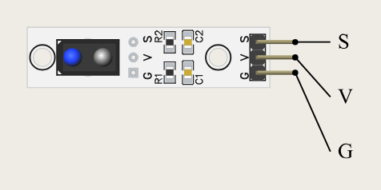
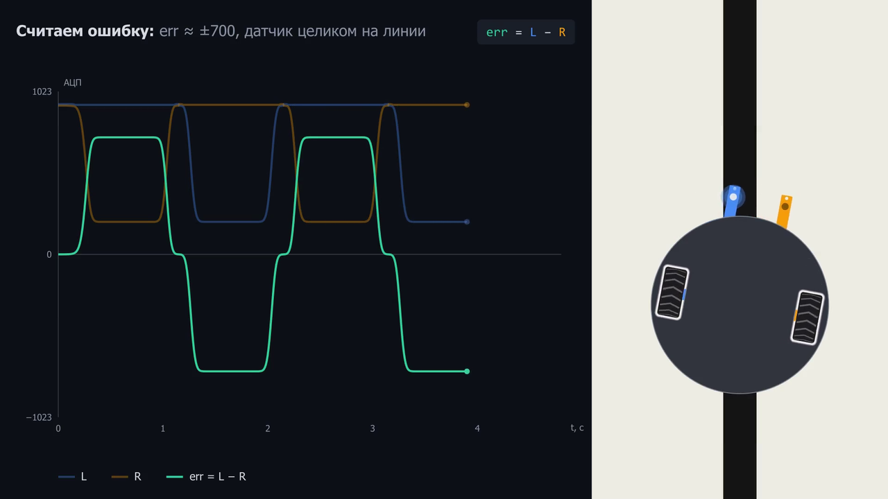
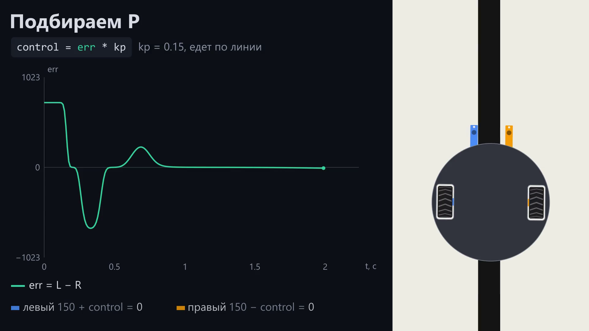
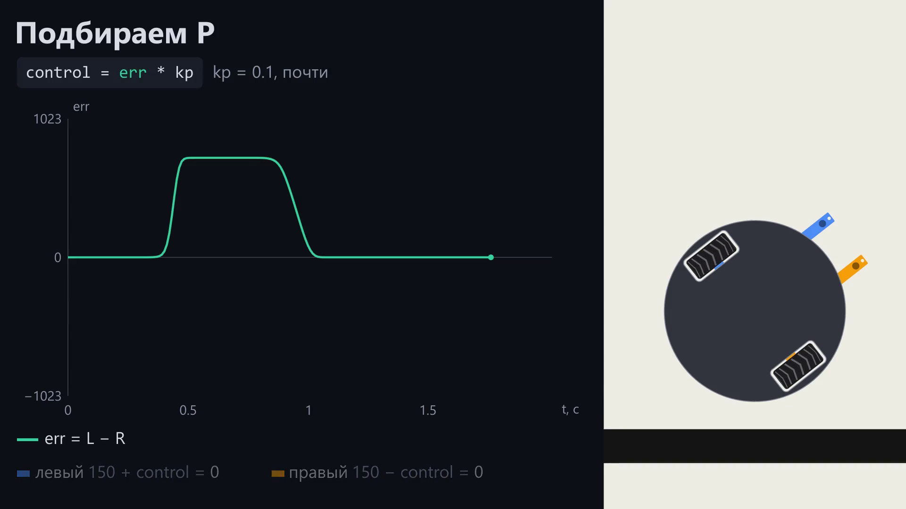
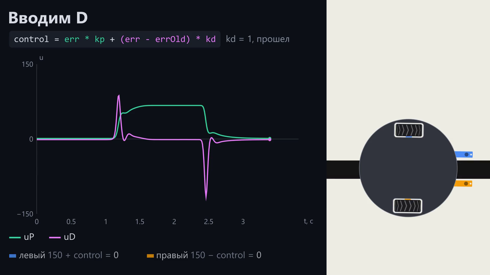
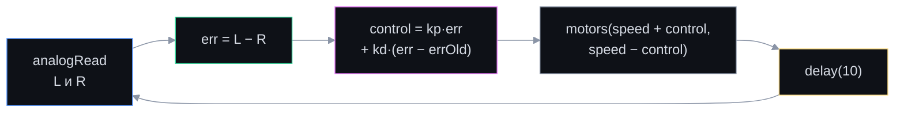
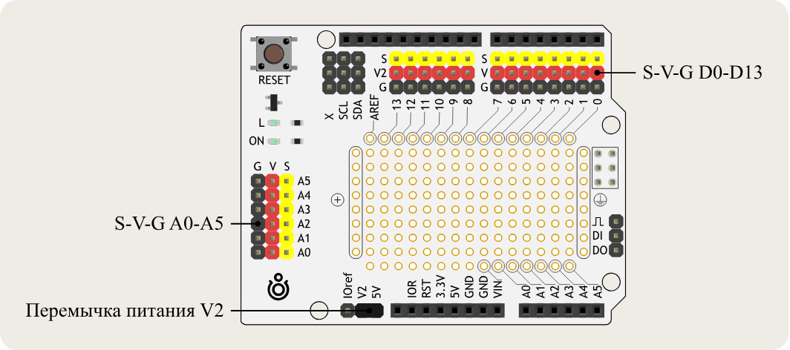

# Урок 2. Датчики линии и ПД-регулятор

[← Урок 1](../lesson-01-movement/) · [Оглавление](../README.md) · [Урок 3 →](../lesson-03-crossroads/)

## Цель

Подключить датчики линии и измерить их показания над белой и черной поверхностью. Научиться вычислять ошибку по разности показаний. Затем настроить ПД-регулятор, который управляет скоростями колес и удерживает робота на линии. В конце занятия робот должен проходить трассу без потери линии и заметных колебаний на прямых участках.

## Теория

### Датчик линии

Датчик построен на оптопаре TCRT5000: инфракрасный светодиод светит вниз, а фототранзистор рядом с ним ловит
отраженный свет. Белая поверхность отражает много света, черная почти весь поглощает, поэтому чем светлее
поверхность под датчиком, тем выше напряжение на его выходе S. Это напряжение контроллер измеряет командой
`analogRead()` и получает число от 0 до 1023. Показания двух датчиков над одной и той же поверхностью могут немного различаться – например, примерно на 5 %. Перед настройкой регулятора измерьте показания каждого датчика над белым и черным. Используйте результаты измерений на своем роботе, а не значения из примеров.

### Калибровка

Прежде чем ехать, посмотрим, что видят датчики. Функция `sensors()` печатает в порт три числа: показания
левого датчика L, правого R и их разность. В плоттере порта (скорость 115200) это три кривые. Поставьте
робота так, чтобы оба датчика были над белым, затем над черным, и запишите показания – они понадобятся в
уроке 3. На видео робота поворачивают рукой над линией: когда датчик целиком над черным, разность
велика по модулю, а когда линия между датчиками, оба видят белое и разность близка к нулю.

[Видео: как датчики видят линию](https://alekseigrachev2002-maker.github.io/Olympiad-Robot-Lessons/assets/video/scene-1-error.mp4)

### Ошибка и ее знак

Ошибку вычисляем как разность показаний: `err = L − R`. По ее знаку определяем, в какую сторону нужно повернуть робота. Пусть робот
съехал с линии вправо: левый датчик наехал на черную линию и показывает меньше правого. Разность отрицательная. Для пропорционального регулятора с положительным `kp` управляющее воздействие `control` тоже будет отрицательным. Чтобы вернуться, робот должен
повернуть налево, то есть левое колесо должно крутиться медленнее правого. Поэтому левому мотору мы
`control` прибавляем, а у правого вычитаем: `motors(speed + control, speed − control)`.

### Пропорциональная часть

Самый простой способ ехать по линии – *релейный*: видим линию слева – резко поворачиваем налево, справа –
направо. Робот при этом дергается от края к краю. Пропорциональный регулятор поворачивает тем сильнее, чем
дальше робот съехал: `control = kp·err`. Коэффициент `kp` переводит ошибку в разницу скоростей: при ошибке
200 и `kp = 0.1` одно колесо крутится на 20 быстрее базовой скорости, другое на 20 медленнее.

### Подбор P

Увеличиваем `kp` от нуля. В широком диапазоне значений робот уже едет по линии, и по прямому участку трудно понять, подходит ли коэффициент. Критерий настройки – прохождение самого крутого поворота трассы. Большой `kp` помогает пройти поворот, но на прямой робот начинает раскачиваться. Эти колебания уменьшают среднюю скорость движения. Затем уменьшаем `kp` до значения, при котором робот только начинает терять линию на повороте.

[Видео: подбор P на прямой](https://alekseigrachev2002-maker.github.io/Olympiad-Robot-Lessons/assets/video/scene-2a-p.mp4)

[Видео: съезд P на повороте](https://alekseigrachev2002-maker.github.io/Olympiad-Robot-Lessons/assets/video/scene-2b-turn.mp4)

Числа на видео взяты из модели робота, у вашего робота они будут другими – важен порядок действий.

### Дифференциальная часть

Теперь добавляем D. Эта часть смотрит не на саму ошибку, а на то, как быстро она меняется:
`kd·(err − errOld)`, где `errOld` – ошибка на прошлом шаге. На входе в поворот ошибка начинает расти, и
D-часть срабатывает первой – робот подруливает раньше, чем P-часть успеет набрать силу. А на прямой, когда
робот возвращается к линии и ошибка быстро уменьшается, D-часть притормаживает поворот и гасит раскачку.
Робот снова проходит поворот, но уже без раскачки на прямой.

[Видео: вводим D](https://alekseigrachev2002-maker.github.io/Olympiad-Robot-Lessons/assets/video/scene-2c-d.mp4)

В этом уроке сначала подбираем `kp`, а затем добавляем D-часть. Начинаем с небольшого `kp`, при котором робот уже следует по линии, но еще не проходит самый крутой поворот. Затем увеличиваем `kd`, чтобы добиться прохождения поворота без заметных колебаний на прямой. Так можно увидеть, что меняется именно после добавления D-части, а не компенсировать ею колебания от слишком большого `kp`.

### Шаг цикла

D-часть сравнивает ошибку с той, что была один проход `loop()` назад, поэтому ее величина зависит от длины
этого прохода. Мы задаем шаг сами – `delay(10)` в конце `loop()`, все остальное в цикле выполняется
намного быстрее. Без задержки регулятор тоже будет работать: какая-то задержка есть всегда, но за короткий
проход ошибка меняется меньше, и `kd` придется поставить больше. Отсюда правило: поменяли шаг – подберите
`kd` заново. По этой же причине перед ездой выключают `sensors()`: вывод в порт занимает время и меняет шаг.

## Схема подключения

Датчики стоят снизу платформы и подключаются к тройкам Troyka Shield: левый – к A0, правый – к A1.
На шлейфе желтый провод – сигнал S, красный – питание V, черный – земля G. Перепутать датчики местами –
значит перевернуть знак ошибки, поэтому проверьте подключение до первого заезда.

## Что нового в коде

Функция `motors(...)` стала удобнее. Уровень сигнала направления теперь определяет функция `direction()`, а у `motors(...)` появились
два необязательных аргумента: `invLDir` и `invRDir` – поменять направление левого или правого мотора на
обратное. Это ответ к первому заданию урока 1: моторы стоят на шасси зеркально и подключены одинаково,
поэтому левый для движения вперед должен крутиться в обратную сторону – по умолчанию `invLDir = true`.
Аргументы со значением по умолчанию можно не писать, так что вызов `motors(138, 150)` из урока 1 работает
без изменений.

Функция `followLine()` – один шаг регулятора: прочитать датчики, посчитать ошибку и `control`, задать
скорости моторов. Переменная `errOld` объявлена как `static`: обычная переменная внутри функции создается
заново при каждом вызове, а `static` хранит значение между вызовами – иначе регулятор не помнил бы прошлую
ошибку. Подробнее о `static` – в уроке 3.

Скетч: [`lesson-02-line-pd.ino`](firmware/lesson-02-line-pd/lesson-02-line-pd.ino)

## Задания

| TODO | Что сделать |
|---|---|
| 1 | Калибровка: откройте плоттер, поставьте робота датчиками на белое, потом на черное, запишите показания обоих датчиков |
| 2 | Проверьте знак: закомментируйте `sensors()`, включите `followLine()` и задайте `kp = 0.1`, `kd = 0`. Удерживая робота с поднятыми колесами, расположите черную линию под левым датчиком, а белую поверхность – под правым. Левое колесо должно вращаться медленнее правого, а светодиод E2 на Motor Shield – гореть тусклее E1 |
| 3 | Подберите `kp`: поднимайте его, пока робот не пройдет самый крутой поворот трассы, затем уменьшайте, пока не перестанет вписываться |
| 4 | Подберите `kd`: с найденным `kp` увеличивайте `kd`, пока робот снова не пройдет поворот без раскачки на прямой |

## Как проверить

Робот проходит прямую без раскачки, а самый крутой поворот трассы – не вылетая с линии. Если робот после
поворота несколько раз пересекает линию из стороны в сторону и только потом успокаивается, `kd` еще мал. Проверяйте на
той же скорости `speed`, на которой будете ехать: коэффициенты подбираются под скорость.

## Частые ошибки

| Что происходит | В чем причина |
|---|---|
| Плоттер не отображает показания корректно | Плоттер открыт на 9600, а нужно 115200 |
| Робот едет прямо и не замечает линию | `kp = 0` или `followLine()` еще закомментирована |
| Робот уходит от линии, а не к ней | Датчики перепутаны местами: левый должен быть на A0, правый на A1 |
| Поведение робота меняется, когда включили `sensors()` | Вывод в порт занимает время и меняет шаг цикла |
| `kp` с видео не подходит | Числа на видео взяты из модели, у реального робота свои |

## Подумать

Что будет, если перепутать знаки и написать `motors(speed − control, speed + control)`?

Почему, если убрать `delay(10)`, `kd` придется увеличить?
