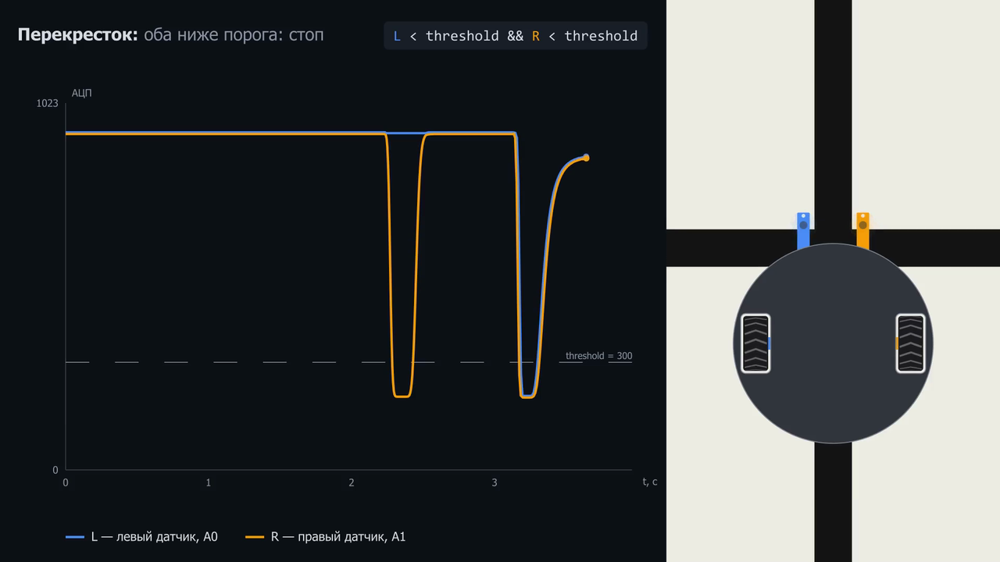

# Урок 3. Перекрестки

[← Урок 2](../lesson-02-line-pd/) · [Оглавление](../README.md)

## Цель

Научить робота определять перекрестки по показаниям двух датчиков, считать их и останавливаться на третьем. ПД-регулятор из урока 2 остается без изменений. К программе добавляется функция `crossRoad()`, которая определяет заезд на перекресток и увеличивает счетчик.

## Теория

### Как датчики видят перекресток

При движении по линии она находится между датчиками, и оба видят белую поверхность. Если робот отклоняется от линии, один из датчиков оказывается над черным. На перекрестке поперечная линия проходит под обоими датчиками одновременно. Поэтому для нашей трассы признаком перекрестка считаем черное под обоими датчиками. Если черное видит только один датчик, этого недостаточно: такое бывает и при прохождении поворота. На видео робот доезжает до перекрестка и останавливается в тот момент, когда показания
обоих датчиков опускаются ниже порога.

[Видео: перекресток](https://alekseigrachev2002-maker.github.io/Olympiad-Robot-Lessons/assets/video/scene-3-cross.mp4)

### Порог

Чтобы решить, черное под датчиком или белое, показание сравнивают с *порогом* `THRESHOLD`: ниже порога –
черное. Порог должен находиться между показаниями на черной и белой поверхностях, которые вы записали в уроке 2. Если используется общий порог для двух датчиков, проверьте, что для каждого из них показание на черном ниже порога, а на белом – выше.

Датчики установлены впереди колес, поэтому определяют перекресток до того, как до него доедут колеса. После команды `motors(0, 0)` робот может еще немного проехать по инерции. Подберите порог по своим измерениям, затем проверьте на треке, где робот останавливается.

### Срабатывание по фронту

Функция `crossRoad()` вызывается примерно каждые 10 мс, а робот проезжает перекресток за десятки миллисекунд. Если
прибавлять единицу каждый раз, когда оба датчика видят черное, за один перекресток счетчик вырастет на
несколько единиц. Считать нужно не *состояние* «стою на перекрестке», а *событие* – момент заезда, когда
сейчас робот на перекрестке (`isCross`), а на прошлом шаге его там не было (`!wasCross`). Такое событие
называют фронтом сигнала. Чтобы определить такой переход, функция хранит предыдущее состояние в `wasCross`. После проверки она записывает в `wasCross` текущее значение `isCross`.

| Шаг `loop()` | `isCross` | `wasCross` до обновления | `count` после проверки |
|---|---|---|---|
| 1 – до перекрестка | false | false | 0 |
| 2 – заезд | true | false | 1 |
| 3 – на перекрестке | true | true | 1 |
| 4 – на перекрестке | true | true | 1 |
| 5 – съезд | false | true | 1 |

### Переменные static

Если объявить внутри функции обычную локальную переменную `int count = 0;`, при каждом вызове функции она будет снова получать значение 0. Локальная переменная с `static` сохраняет значение между вызовами. Поэтому счетчик `count` и предыдущее состояние `wasCross` должны быть статическими. По той же причине в регуляторе используется статическая переменная `errOld`.

### Остановка навсегда

Одной команды `motors(0, 0)` недостаточно: `loop()` начнется заново, и если на следующем шаге программа
снова вызовет `followLine()`, регулятор включит моторы. Надежнее после остановки поставить пустой
бесконечный цикл `while (true) {}` – программа останется в нем, до сброса контроллера или выключения питания.

## Схема подключения

Подключение не меняется с урока 2: левый датчик – A0, правый – A1, моторы – M2 и M1.

## Что нового в коде

Порог задает `#define THRESHOLD`, номер перекрестка для остановки – `#define STOP_AT 3`. Функция
`crossRoad()` возвращает, сколько перекрестков робот уже проехал, но в ней три ошибки, и их предстоит
найти. Коэффициенты `kp` и `kd` перенесите из урока 2 – у каждого робота свои.

Скетч: [`lesson-03-crossroads.ino`](firmware/lesson-03-crossroads/lesson-03-crossroads.ino)

## Задания

| TODO | Что сделать |
|---|---|
| 1 | Задайте порог `THRESHOLD` по показаниям на белом и черном из урока 2 |
| 2 | Сделайте так, чтобы счетчик `count` не обнулялся при каждом вызове `crossRoad()` |
| 3 | Исправьте условие: `count` должен увеличиваться только в момент заезда на перекресток |
| 4 | Перед `return` запомните текущее состояние `isCross` в `wasCross` |
| 5 | В `loop()`: пока `crossRoad()` меньше `STOP_AT`, робот едет по линии, затем останавливается навсегда |

## Как проверить

Поставьте робота на линию перед первым перекрестком. Он должен проехать первые два перекрестка и остановиться на третьем. Затем измените `STOP_AT` и повторите заезд: робот должен остановиться на заданном перекрестке без других изменений программы.

## Частые ошибки

| Что происходит | Что проверить |
|---|---|
| Робот останавливается на первом же перекрестке | Счетчик увеличивается несколько раз за один проезд. Проверьте условие заезда на перекресток и обновление `wasCross` |
| Робот не останавливается | Проверьте, сохраняется ли `count` между вызовами `crossRoad()`: счетчик должен быть объявлен с `static` |
| Робот останавливается раньше заданного перекрестка | Проверьте порог: если он слишком высокий, оба датчика могут определять черное еще до перекрестка |
| Робот проезжает перекрестки, не считая их | Проверьте порог: если он слишком низкий, показания даже над черным остаются выше него |
| Робот останавливается, а затем снова начинает ехать | Проверьте, не вызывается ли `followLine()` после команды `motors(0, 0)` |

## Подумать

Что будет, если робот заедет на перекресток наискосок и один датчик увидит черное раньше другого?

Как сделать, чтобы робот остановился на третьем перекрестке на две секунды, а потом поехал дальше?
